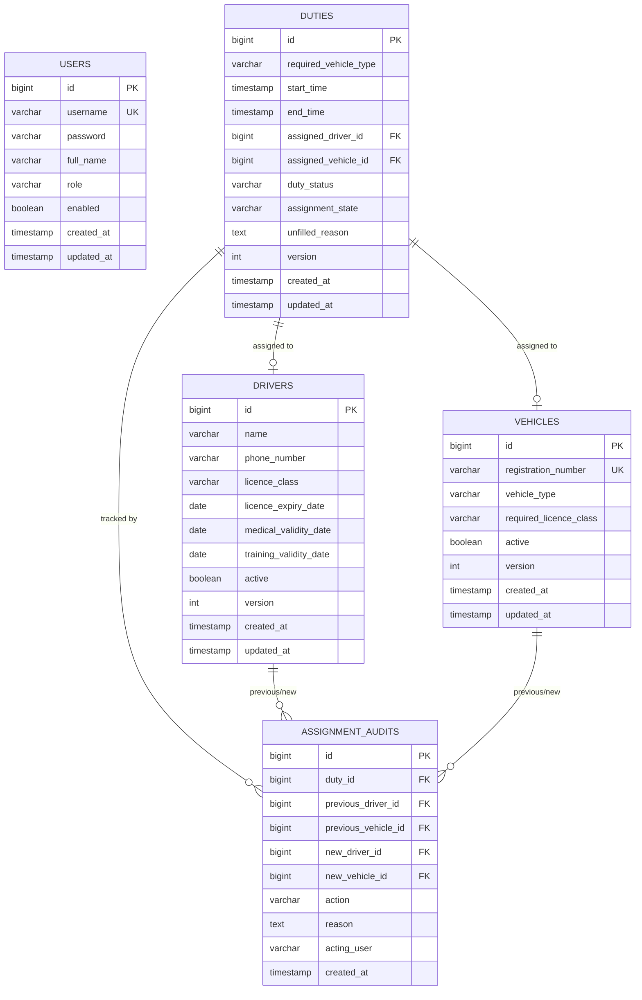
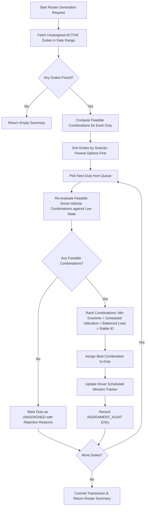

# MoveInSync Driver Duty Roster & Assignment System

A production-grade backend service built for the **MoveInSync SDE Java Backend Hiring Assessment (Case Study 6: Driver Duty Roster & Assignment)**. The system schedules commercial transport drivers and vehicles to duty requirements under strict operational safety invariants, credential validity constraints, rest-hour regulations, and greedy scarcity-first workload balancing.

---

## 1. Project Overview & Problem Statement

Commercial fleet management and corporate commute systems require assigning drivers and vehicles to fixed duty shifts while upholding strict regulatory and safety standards:
- Drivers must hold valid licences matching vehicle classifications (`HMV` vs `LMV`).
- Medical and mandatory training certificates must remain active through the end of the shift.
- Overlapping duties are forbidden for both drivers and vehicles.
- A mandatory minimum rest period of 8 consecutive hours must be maintained between shifts.
- When driver dropouts happen (e.g., sudden sickness), the system must reassign shifts safely, preserving audit history without causing cascading conflicts.

This service implements a deterministic, constraint-first greedy assignment engine with comprehensive conflict tracking, utilization reporting, JWT role-based security, caching, monitoring, and audit trails.

---

## 2. Functional Requirements & Implemented Features

1. **Driver Management**: Complete lifecycle tracking with licence class (`LMV`/`HMV`), validity dates (licence, medical, training), active status, and PII masking.
2. **Vehicle Management**: Uniqueness on registration number, classification (`CAB`, `BUS`, `SHUTTLE`), and licence policy mapping.
3. **Duty Lifecycle**: Distinct `dutyStatus` (`ACTIVE`, `COMPLETED`, `CANCELLED`) and `assignmentState` (`ASSIGNED`, `UNASSIGNED`). Cancellation unassigns resources and writes audit records.
4. **Eligibility Engine**: Non-negotiable hard invariants:
   - Driver active & available
   - Centralized vehicle-to-licence compatibility policy (`BUS` requires `HMV`, `CAB`/`SHUTTLE` require `LMV`)
   - Driver credentials valid through duty end (including cross-midnight shifts)
   - Zero overlap on half-open intervals `[start, end)` for both driver and vehicle
   - Minimum 8 full hours of rest before and after adjacent duties
5. **Roster Generation Engine**: Constrained, scarcity-first greedy heuristic ranking feasible combinations by incremental overtime minimization and existing driver utilization.
6. **Driver Dropout & Reassignment**: Atomic reassignment excluding unavailable drivers, preserving previous assignments in immutable audit logs.
7. **Reporting & Analytics**:
   - Conflict report detailing unfilled duties and candidate rejection reasons.
   - Resource utilization report calculating scheduled hours, baseline capacity, utilization percentage, and overtime hours.
   - Chronological assignment audit history.
8. **Authentication & RBAC**: Real Spring Security with JWT tokens supporting `ADMIN`, `APPROVER`, and `EMPLOYEE` roles.
9. **Observability & Caching**: Caffeine reference cache, Micrometer counters and timers for roster generation, rejection causes, and reassignment metrics.

---

## 3. Technology Stack

- **Language & Runtime**: Java 21 (LTS)
- **Framework**: Spring Boot 3.3.5
- **Build Tool**: Apache Maven 3.9.9
- **Persistence**: Spring Data JPA, Hibernate 6.5
- **Database**: PostgreSQL 16 (production/Docker) & H2 (in-memory test profile)
- **Database Migrations**: Flyway Core (V1 to V5 migrations)
- **Security**: Spring Security 6 with JJWT (0.12.6) HMAC-SHA256
- **Caching**: Caffeine 3.1.8 (`@Cacheable`, `@CacheEvict`)
- **Metrics & Monitoring**: Spring Boot Actuator, Micrometer, Prometheus registry
- **API Documentation**: SpringDoc OpenAPI 2.6.0 (Swagger UI)
- **Testing**: JUnit 5, Mockito, Spring Boot Test, MockMvc
- **Containerization**: Docker multi-stage build & Docker Compose

---

## 4. Architecture & Package Structure

The codebase adheres strictly to layered architecture, domain encapsulation, and separation of concerns:

```
src/main/java/com/moveinsync/roster/
├── DriverDutyRosterApplication.java   # Spring Boot entry point & @EnableCaching
├── config/                           # Application, security, cache, OpenAPI, policy
│   ├── AppConfig.java                # ZoneId, Clock, configurable thresholds
│   ├── DataInitializer.java          # Local dev admin/approver/employee bootstrap
│   ├── OpenApiConfig.java            # Swagger & JWT security schemes
│   ├── SecurityConfig.java           # SecurityFilterChain, RBAC permissions
│   └── VehicleLicencePolicy.java     # Centralized vehicle-to-licence policy
├── controller/                       # REST endpoints with Bean Validation & OpenAPI
│   ├── AuthController.java           # /api/v1/auth/login, /api/v1/auth/me
│   ├── DriverController.java         # /api/v1/drivers CRUD & status
│   ├── DutyController.java           # /api/v1/duties CRUD & status updates
│   ├── ReportController.java         # /api/v1/reports conflicts, utilization, audits
│   ├── RosterController.java         # /api/v1/roster/generate, /api/v1/roster/reassign
│   ├── UserController.java           # /api/v1/users creation
│   └── VehicleController.java        # /api/v1/vehicles CRUD & status
├── dto/                              # Request, Response, Page, and Error DTOs
│   ├── request/                      # Request payloads with validation annotations
│   └── response/                     # Data transfer objects (entities never exposed)
├── exception/                        # Centralized exception handling
│   ├── BusinessRuleException.java
│   ├── DuplicateResourceException.java
│   ├── GlobalExceptionHandler.java   # Sanitized JSON error responses
│   ├── InvalidStateTransitionException.java
│   └── ResourceNotFoundException.java
├── model/
│   ├── entity/                       # JPA entities with optimistic locking versions
│   │   ├── AssignmentAudit.java
│   │   ├── Driver.java
│   │   ├── Duty.java
│   │   ├── User.java
│   │   └── Vehicle.java
│   └── enums/                        # Domain enumerations
│       ├── AssignmentState.java      # ASSIGNED, UNASSIGNED
│       ├── AuditAction.java          # INITIAL_ASSIGNMENT, REASSIGNMENT, CANCELLATION...
│       ├── DutyStatus.java           # ACTIVE, COMPLETED, CANCELLED
│       ├── LicenceClass.java         # LMV, HMV
│       ├── UserRole.java             # ADMIN, APPROVER, EMPLOYEE
│       └── VehicleType.java          # CAB, BUS, SHUTTLE
├── repository/                       # Spring Data JPA repositories with JPQL queries
│   ├── AssignmentAuditRepository.java
│   ├── DriverRepository.java
│   ├── DutyRepository.java           # Half-open interval queries, rest checks, locks
│   ├── UserRepository.java
│   └── VehicleRepository.java
├── security/                         # Security infrastructure
│   ├── CustomUserDetailsService.java
│   ├── JwtAuthenticationEntryPoint.java
│   ├── JwtAuthenticationFilter.java
│   └── JwtTokenProvider.java
└── service/                          # Business logic & algorithms
    ├── AuthService.java
    ├── DriverService.java            # Cached driver operations
    ├── DutyService.java              # Duty validation & lifecycle transitions
    ├── EligibilityService.java       # Centralized non-negotiable invariant checker
    ├── ReportingService.java         # Conflict & utilization computations
    ├── RosterService.java            # Scarcity-first greedy assignment engine
    └── VehicleService.java           # Cached vehicle operations
```

---

## 5. Entity Relationship (ER) Diagram



---

## 6. Main Assignment Workflow



---

## 7. Interval Overlap & Rest-Gap Logic

### Interval Overlap Condition
Duties are treated as half-open intervals `[start, end)`. Two duties $D_1$ and $D_2$ overlap if and only if:
$$\text{start}_1 < \text{end}_2 \quad \text{AND} \quad \text{start}_2 < \text{end}_1$$

- A duty ending at `10:00` and another starting at `10:00` do not overlap:
  $10:00 < 10:00$ evaluates to `false`.
- Cancelling a duty immediately removes it from overlap queries (`dutyStatus <> 'CANCELLED'`).

### Rest-Gap Condition
A driver requires at least eight full hours ($\ge 8\text{h}$) of rest between any consecutive duties:
1. **Backward gap**: $\text{Duration}(\text{Duty}_{\text{prev}}.\text{end}, \text{Duty}_{\text{new}}.\text{start}) \ge 8\text{h}$.
2. **Forward gap**: $\text{Duration}(\text{Duty}_{\text{new}}.\text{end}, \text{Duty}_{\text{next}}.\text{start}) \ge 8\text{h}$.

- Previous duty ends at `10:00`, new duty starts at `18:00`: Gap is $8\text{h }0\text{m} \implies \text{Valid}$.
- Previous duty ends at `10:00`, new duty starts at `17:59`: Gap is $7\text{h }59\text{m} < 8\text{h} \implies \text{Rejected}$.
- Completed historical duties still enforce rest hours on subsequent shifts.

---

## 8. Eligibility & Expiry-Date Rules

Before a driver is assigned:
1. **Active status**: `driver.active == true`.
2. **Licence sufficiency**: Evaluated via `VehicleLicencePolicy`:
   - `BUS` $\to$ requires `HMV`. Drivers with `LMV` are strictly rejected.
   - `CAB` and `SHUTTLE` $\to$ require `LMV`. Both `LMV` and `HMV` drivers satisfy this requirement.
3. **Licence validity**: `licenceExpiryDate >= duty.endTime.toLocalDate()`.
4. **Medical validity**: `medicalValidityDate >= duty.endTime.toLocalDate()`.
5. **Training validity**: `trainingValidityDate >= duty.endTime.toLocalDate()`.
6. **Cross-midnight validity**: If a duty starts on `2026-10-15 22:00` and ends on `2026-10-16 04:00`, credentials expiring on `2026-10-15` are rejected because the duty ends on `2026-10-16`.

---

## 9. Roster Generation Strategy & Objective Function

### Scarcity-First Greedy Heuristic
1. Evaluate each duty's initial feasible candidate combinations.
2. Sort duties in ascending order of candidate count (most constrained duties first).
3. Tie-breaker 1: Earliest start time.
4. Tie-breaker 2: Stable duty ID.
5. As duties are assigned, resource availability changes dynamically; candidate feasibility is re-evaluated live before committing.

### Objective Function
For each duty with multiple feasible $(d, v)$ candidates, the ranking objective prioritizes:
1. **Incremental Overtime Minimization**: Daily shift duration is split at local midnight (`00:00:00`). Regular threshold defaults to 8 hours/day. Hours above 8 in any calendar day are penalized.
2. **Scheduled Driver Utilization**: Drivers already working that calendar day are preferred over idle drivers (grouping shifts efficiently without violating rest rules).
3. **Workload Balance**: Drivers with fewer total lifetime shifts are preferred.
4. **Deterministic Tie-Breaking**: Smallest driver ID, then smallest vehicle ID.

---

## 10. Time & Space Complexity Analysis

### Time Complexity
Let:
- $D$ = number of unassigned duties in the request window
- $V$ = number of active vehicles of matching type
- $Dr$ = number of active drivers
- $Q$ = database lookup time for overlap and rest checks ($O(\log N)$ using B-Tree indexes on `(driver_id, duty_status, start_time, end_time)`).

1. **Scarcity evaluation**: Evaluating initial feasibility counts takes $O(D \cdot V \cdot Dr \cdot Q)$.
2. **Sorting duties**: $O(D \log D)$.
3. **Sequential assignment**: For each duty $D$, evaluating live candidates takes $O(V \cdot Dr \cdot Q)$. Ranking candidates takes $O((V \cdot Dr) \log(V \cdot Dr))$.
4. **Overall Time Complexity**: $O(D \cdot V \cdot Dr \cdot \log N)$.
   In practice, since $V$ is pre-filtered by vehicle type and candidate pruning terminates early on hard rule failures, assignment runs in sub-second time for typical operational windows.

### Space Complexity
- Auxiliary memory: $O(D + Dr)$ for tracking daily work duration maps and candidate lists.
- Database space: $O(N)$ where $N$ is total duties, drivers, and audit records with standard indexing overhead.

---

## 11. Assumptions & Configurable Policies

1. **Vehicle-to-Licence Policy**: Configured in `VehicleLicencePolicy.java`. Default: `BUS` $\to$ `HMV`; `CAB`/`SHUTTLE` $\to$ `LMV`. Can be adjusted without changing service code.
2. **Rest-Hour Threshold**: Default 8 hours (`app.roster.rest-hours: 8`).
3. **Regular Work Day Baseline**: Default 8 hours/day (`app.roster.regular-work-hours-per-day: 8`). Used for overtime calculations and utilization percentages.
4. **Timezone**: Default `Asia/Kolkata` (`app.timezone: Asia/Kolkata`). Deterministic via injected `Clock` bean.

---

## 12. Known Limitations & Trade-Offs

- **Greedy Heuristic vs. Mixed-Integer Linear Programming (MILP)**:
  A greedy heuristic runs in polynomial time and produces explainable results. However, greedy heuristics are not guaranteed to find a mathematically global optimal roster in heavily constrained scenarios where backtracking could fill an additional duty.
- **Transactional Consistency vs. Maximum Concurrency**:
  Duty reassignment uses pessimistic locking (`SELECT ... FOR UPDATE`), preventing race conditions and double bookings at the cost of slight serialization during peak concurrency.
- **Reference Data Caching**:
  Driver and vehicle profiles are cached in Caffeine (`maximumSize=500`, `expireAfterWrite=10m`). Updates evict the cache. Roster generation and eligibility checks always consult authoritative database state.

---

## 13. Authentication, Authorization & Local Bootstrap

The application uses Spring Security with JWT (HMAC-SHA256).

### Role Permission Matrix
| Endpoint | Method | ADMIN | APPROVER | EMPLOYEE |
|---|---|:---:|:---:|:---:|
| `/api/v1/auth/login` | POST | Yes | Yes | Yes |
| `/api/v1/auth/me` | GET | Yes | Yes | Yes |
| `/api/v1/drivers/**` | GET | Yes | Yes | No |
| `/api/v1/drivers/**` | POST, PUT, PATCH | Yes | No | No |
| `/api/v1/vehicles/**` | GET | Yes | Yes | No |
| `/api/v1/vehicles/**` | POST, PUT, PATCH | Yes | No | No |
| `/api/v1/duties/**` | GET | Yes | Yes | Yes |
| `/api/v1/duties/**` | POST, PUT, PATCH | Yes | No | No |
| `/api/v1/roster/generate` | POST | Yes | No | No |
| `/api/v1/roster/reassign` | POST | Yes | No | No |
| `/api/v1/reports/**` | GET | Yes | Yes | No |
| `/api/v1/users/**` | POST | Yes | No | No |
| `/actuator/**` | GET | Yes | No | No |

### Default Bootstrap Credentials
When started on an empty database, `DataInitializer` seeds:
- `admin` / `admin123` (`ROLE_ADMIN`)
- `approver` / `approver123` (`ROLE_APPROVER`)
- `employee` / `employee123` (`ROLE_EMPLOYEE`)

---

## 14. Environment Variables

| Variable | Default Value | Description |
|---|---|---|
| `DATABASE_URL` | `jdbc:postgresql://localhost:5432/roster_db` | PostgreSQL JDBC connection URL |
| `DB_USERNAME` | `roster_user` | PostgreSQL database user |
| `DB_PASSWORD` | `roster_pass` | PostgreSQL database password |
| `JWT_SECRET` | `defaultDevSecretKeyThatIsAtLeast256BitsLongForHS256Algorithm123` | Minimum 256-bit secret key |
| `JWT_EXPIRATION_MS` | `3600000` (1 hour) | JWT token lifespan in milliseconds |
| `APP_TIMEZONE` | `Asia/Kolkata` | Application timezone |
| `ROSTER_REST_HOURS` | `8` | Minimum rest gap between duties |
| `ROSTER_REGULAR_HOURS` | `8` | Baseline regular hours per day |

---

## 15. Local Setup using Docker Compose & Maven

### Prerequisites
- Java 21 JDK
- Apache Maven 3.9+
- Docker & Docker Compose (optional for local PostgreSQL)

### Option A: Local Development (PostgreSQL in Docker)
```powershell
# 1. Start PostgreSQL
docker compose up -d postgres

# 2. Build and run application
mvn clean spring-boot:run
```

### Option B: Full Docker Deployment
```powershell
# Build and run application & database containers together
docker compose up --build
```

The application starts on `http://localhost:8080`.
- Swagger UI: `http://localhost:8080/swagger-ui.html`
- OpenAPI Specification: `http://localhost:8080/api-docs`
- Actuator Health: `http://localhost:8080/actuator/health`
- Prometheus Metrics: `http://localhost:8080/actuator/prometheus`

---

## 16. Database Migration Instructions

Flyway handles schema migrations automatically on application startup from `src/main/resources/db/migration/`:
- `V1__create_users_table.sql`: Users table and role check constraints
- `V2__create_drivers_table.sql`: Drivers table, licence enum constraints, indexes
- `V3__create_vehicles_table.sql`: Vehicles table, registration uniqueness constraint, indexes
- `V4__create_duties_table.sql`: Duties table, foreign keys, half-open range indexes, `chk_duty_time`
- `V5__create_assignment_audit_table.sql`: Immutable assignment audit trail

To run migrations manually via Maven:
```powershell
mvn flyway:migrate
```

---

## 17. Automated Testing & Verification Results

All 22 required scenarios from Section 13 were implemented and executed across unit and integration suites:

```powershell
# Execute complete test suite
mvn test
```

### Actual Test Execution Results
```
[INFO] Running com.moveinsync.roster.integration.ConcurrencyAndReliabilityTest
[INFO] Tests run: 1, Failures: 0, Errors: 0, Skipped: 0 -- in ConcurrencyAndReliabilityTest
[INFO] Running com.moveinsync.roster.integration.SecurityAndValidationTest
[INFO] Tests run: 6, Failures: 0, Errors: 0, Skipped: 0 -- in SecurityAndValidationTest
[INFO] Running com.moveinsync.roster.service.DutyStateTransitionTest
[INFO] Tests run: 4, Failures: 0, Errors: 0, Skipped: 0 -- in DutyStateTransitionTest
[INFO] Running com.moveinsync.roster.service.EligibilityServiceTest
[INFO] Tests run: 13, Failures: 0, Errors: 0, Skipped: 0 -- in EligibilityServiceTest
[INFO] Running com.moveinsync.roster.service.ReassignmentTest
[INFO] Tests run: 2, Failures: 0, Errors: 0, Skipped: 0 -- in ReassignmentTest
[INFO] Running com.moveinsync.roster.service.ReportingServiceTest
[INFO] Tests run: 2, Failures: 0, Errors: 0, Skipped: 0 -- in ReportingServiceTest
[INFO] Running com.moveinsync.roster.service.RosterServiceTest
[INFO] Tests run: 2, Failures: 0, Errors: 0, Skipped: 0 -- in RosterServiceTest
[INFO] 
[INFO] Results:
[INFO] 
[INFO] Tests run: 30, Failures: 0, Errors: 0, Skipped: 0
[INFO] ------------------------------------------------------------------------
[INFO] BUILD SUCCESS
[INFO] ------------------------------------------------------------------------
```

### Mandatory Scenarios Verified
- **Scenario 1**: Valid HMV driver assigned to BUS duty (`PASSED`)
- **Scenario 2**: LMV driver rejected for BUS duty (`PASSED`)
- **Scenario 3**: Expired licence prevents assignment (`PASSED`)
- **Scenario 4**: Expired medical clearance prevents assignment (`PASSED`)
- **Scenario 5**: Expired training certificate prevents assignment (`PASSED`)
- **Scenario 6**: Expiry before cross-midnight duty end prevents assignment (`PASSED`)
- **Scenario 7**: Exactly 8h rest gap is accepted (`PASSED`)
- **Scenario 8**: Less than 8h rest gap (7h 59m) is rejected (`PASSED`)
- **Scenario 9**: Overlapping duties for driver rejected (`PASSED`)
- **Scenario 10**: Overlapping duties for vehicle rejected (`PASSED`)
- **Scenario 11**: Back-to-back duties accepted when rest gap satisfied (`PASSED`)
- **Scenario 12**: Cancelled duties do not block assignment (`PASSED`)
- **Scenario 13**: Completed duty rest gap affects subsequent assignments (`PASSED`)
- **Scenario 14**: Unavailable driver excluded from reassignment (`PASSED`)
- **Scenario 15**: Reassignment records previous/new details in audit trail (`PASSED`)
- **Scenario 16**: Unfilled duty returned in conflict report with exact cause (`PASSED`)
- **Scenario 17**: Driver & vehicle utilization and overtime calculations (`PASSED`)
- **Scenario 18**: Invalid request returns structured validation errors (`PASSED`)
- **Scenario 19**: 401 Unauthorized and 403 Forbidden role enforcement (`PASSED`)
- **Scenario 20**: Repeated/duplicate vehicle registration rejected (`PASSED`)
- **Scenario 21**: Reassignment failure preserves state consistency (`PASSED`)
- **Scenario 22**: Concurrent assignment attempts cannot cause double bookings (`PASSED`)

---

## 18. API Endpoints & Sample Requests

### 1. Authenticate
```http
POST /api/v1/auth/login
Content-Type: application/json

{
  "username": "admin",
  "password": "admin123"
}
```
**Response (200 OK):**
```json
{
  "token": "eyJhbGciOiJIUzI1NiIsInR5cCI6IkpXVCJ9...",
  "username": "admin",
  "role": "ADMIN",
  "expiresIn": 3600000
}
```

### 2. Create Driver
```http
POST /api/v1/drivers
Authorization: Bearer <TOKEN>
Content-Type: application/json

{
  "name": "Rajesh Kumar",
  "phoneNumber": "+919876543210",
  "licenceClass": "HMV",
  "licenceExpiryDate": "2027-12-31",
  "medicalValidityDate": "2027-12-31",
  "trainingValidityDate": "2027-12-31"
}
```

### 3. Create Vehicle
```http
POST /api/v1/vehicles
Authorization: Bearer <TOKEN>
Content-Type: application/json

{
  "registrationNumber": "KA01BUS1001",
  "vehicleType": "BUS"
}
```

### 4. Create Duty
```http
POST /api/v1/duties
Authorization: Bearer <TOKEN>
Content-Type: application/json

{
  "requiredVehicleType": "BUS",
  "startTime": "2026-10-20T06:00:00",
  "endTime": "2026-10-20T10:00:00"
}
```

---

## 19. Sample Roster Generation Response

```http
POST /api/v1/roster/generate
Authorization: Bearer <TOKEN>
Content-Type: application/json

{
  "startTime": "2026-10-20T00:00:00",
  "endTime": "2026-10-20T23:59:59"
}
```

**Response (200 OK):**
```json
{
  "totalDuties": 2,
  "assignedDuties": 1,
  "unfilledDuties": 1,
  "assignments": [
    {
      "id": 1,
      "requiredVehicleType": "BUS",
      "startTime": "2026-10-20T06:00:00",
      "endTime": "2026-10-20T10:00:00",
      "assignedDriverId": 1,
      "assignedDriverName": "Rajesh Kumar",
      "assignedVehicleId": 1,
      "assignedVehicleRegistration": "KA01BUS1001",
      "dutyStatus": "ACTIVE",
      "assignmentState": "ASSIGNED",
      "unfilledReason": null,
      "createdAt": "2026-10-12T16:50:00",
      "updatedAt": "2026-10-12T16:51:00"
    }
  ],
  "unfilled": [
    {
      "id": 2,
      "requiredVehicleType": "BUS",
      "startTime": "2026-10-20T12:00:00",
      "endTime": "2026-10-20T16:00:00",
      "assignedDriverId": null,
      "assignedDriverName": null,
      "assignedVehicleId": null,
      "assignedVehicleRegistration": null,
      "dutyStatus": "ACTIVE",
      "assignmentState": "UNASSIGNED",
      "unfilledReason": "No eligible assignment: REST_RULE=1",
      "createdAt": "2026-10-12T16:50:00",
      "updatedAt": "2026-10-12T16:51:00"
    }
  ],
  "generationTimeMs": "48"
}
```

---

## 20. Sample Conflict & Utilization Reports

### Conflict Report
```http
GET /api/v1/reports/conflicts?startTime=2026-10-20T00:00:00&endTime=2026-10-20T23:59:59
Authorization: Bearer <TOKEN>
```
**Response:**
```json
{
  "totalDuties": 2,
  "assignedDuties": 1,
  "unfilledDuties": 1,
  "unfilledDetails": [
    {
      "dutyId": 2,
      "requiredVehicleType": "BUS",
      "startTime": "2026-10-20T12:00:00",
      "endTime": "2026-10-20T16:00:00",
      "reason": "No eligible assignment: REST_RULE=1"
    }
  ],
  "rejectionCountsByReason": {
    "REST_RULE": 1
  },
  "summary": "1 of 2 duties assigned. 1 unfilled."
}
```

### Driver Utilization Report
```http
GET /api/v1/reports/utilization/drivers?startTime=2026-10-20T00:00:00&endTime=2026-10-20T23:59:59
Authorization: Bearer <TOKEN>
```
**Response:**
```json
[
  {
    "driverId": 1,
    "driverName": "Rajesh Kumar",
    "licenceClass": "HMV",
    "assignedDuties": 2,
    "totalScheduledHours": 10.0,
    "utilizationPercentage": 125.0,
    "overtimeHours": 2.0,
    "available": true
  }
]
```

---

## 21. Caching Behavior & Invalidation

- **Engine**: In-memory Caffeine cache (`maximumSize=500`, `expireAfterWrite=10m`).
- **Cached Items**:
  - `drivers`: Driver profiles by ID (`@Cacheable(value = "drivers", key = "#id")`).
  - `vehicles`: Vehicle profiles by ID (`@Cacheable(value = "vehicles", key = "#id")`).
- **Cache Invalidation**:
  - Creating, updating, or toggling active status evicts the specific key or entire cache collection (`@CacheEvict(value = "drivers", key = "#id")`).
- **Guaranteed Consistency**:
  - Feasibility, overlap, and rest checks **never** read from cache. Every write and roster run validates authoritative database state with ACID transactions.

---

## 22. Monitoring & Structured Logging

### Metrics Exposed via Actuator & Micrometer
- `roster.generation.attempts`: Total roster runs
- `roster.generation.duration`: Timer measuring execution latency
- `roster.assignments.successful`: Count of assigned duties
- `roster.duties.unfilled`: Count of unassigned duties
- `roster.rejections.rest_rule`: Candidates rejected due to < 8h rest gap
- `roster.rejections.driver_overlap`: Candidates rejected due to shift overlap
- `roster.rejections.vehicle_conflict`: Rejections due to vehicle double-booking
- `roster.rejections.licence`: Rejections due to licence mismatch
- `roster.reassignment.attempts` & `roster.reassignment.successful`: Reassignment tracking

Prometheus endpoint: `GET /actuator/prometheus` (Admin authorized).

### Structured Logging
Logs output ISO-8601 timestamps, log level, thread name, logger category, and correlation context without logging passwords, JWT tokens, or raw phone numbers.

---

## 23. Backup & Recovery Procedure

### Automated vs. Non-Automated
- **Automated**: PostgreSQL transaction Write-Ahead Logging (WAL) ensures point-in-time recovery from crashes. Docker named volume `pgdata` retains data across container restarts.
- **Manual Backups**: Logical database dumps using `pg_dump`.

### Backup Command
```powershell
docker exec -t roster-postgres pg_dump -U roster_user -d roster_db -F c -b -v -f /tmp/roster_db_backup.dump
docker cp roster-postgres:/tmp/roster_db_backup.dump ./backups/roster_db_$(Get-Date -Format 'yyyyMMdd_HHmmss').dump
```

### Restore Command
```powershell
docker cp ./backups/roster_db_backup.dump roster-postgres:/tmp/roster_db_backup.dump
docker exec -t roster-postgres pg_restore -U roster_user -d roster_db -c -v /tmp/roster_db_backup.dump
```

---

## 24. Demonstration Plan

The complete 10-step verification workflow can be run in Postman (`postman/MoveInSync_Roster_API.postman_collection.json`) or Swagger UI (`http://localhost:8080/swagger-ui.html`):

1. **Authenticate**: Call `POST /api/v1/auth/login` with `admin` / `admin123`. Copy JWT bearer token.
2. **Register Drivers**:
   - Create Driver `D1` with `HMV` licence (`POST /api/v1/drivers`).
   - Create Driver `D2` with `LMV` licence (`POST /api/v1/drivers`).
3. **Register Vehicles**:
   - Register Vehicle `V1` of type `BUS` (`POST /api/v1/vehicles`).
   - Register Vehicle `V2` of type `CAB` (`POST /api/v1/vehicles`).
4. **Create Duties**:
   - Create Duty `DT1`: `BUS`, `06:00 - 10:00` (`POST /api/v1/duties`).
   - Create Duty `DT2`: `CAB`, `06:00 - 10:00` (`POST /api/v1/duties`).
5. **Generate Roster**: Call `POST /api/v1/roster/generate`. Inspect response: `DT1` assigned to `D1` + `V1`; `DT2` assigned to `D2` + `V2`.
6. **Attempt Rest-Hour Violation**:
   - Create Duty `DT3`: `BUS`, `12:00 - 16:00` (only 2 hours after `DT1` ended).
   - Call `POST /api/v1/roster/generate`. Inspect response: `DT3` remains `UNASSIGNED` with reason `No eligible assignment: REST_RULE=1`.
7. **Simulate Driver Dropout**:
   - Call `POST /api/v1/roster/reassign` for `DT1`, passing `unavailableDriverId=1` and reason `"Sudden illness"`.
8. **Inspect Audit History**:
   - Call `GET /api/v1/reports/duties/1/audit`. Verify previous driver `1` and audit reason are recorded.
9. **Review Conflict Report**:
   - Call `GET /api/v1/reports/conflicts`. Verify `DT3` appears with rest rule rejection counter.
10. **Review Resource Utilization**:
    - Call `GET /api/v1/reports/utilization/drivers`. Inspect scheduled hours, utilization %, and overtime.
